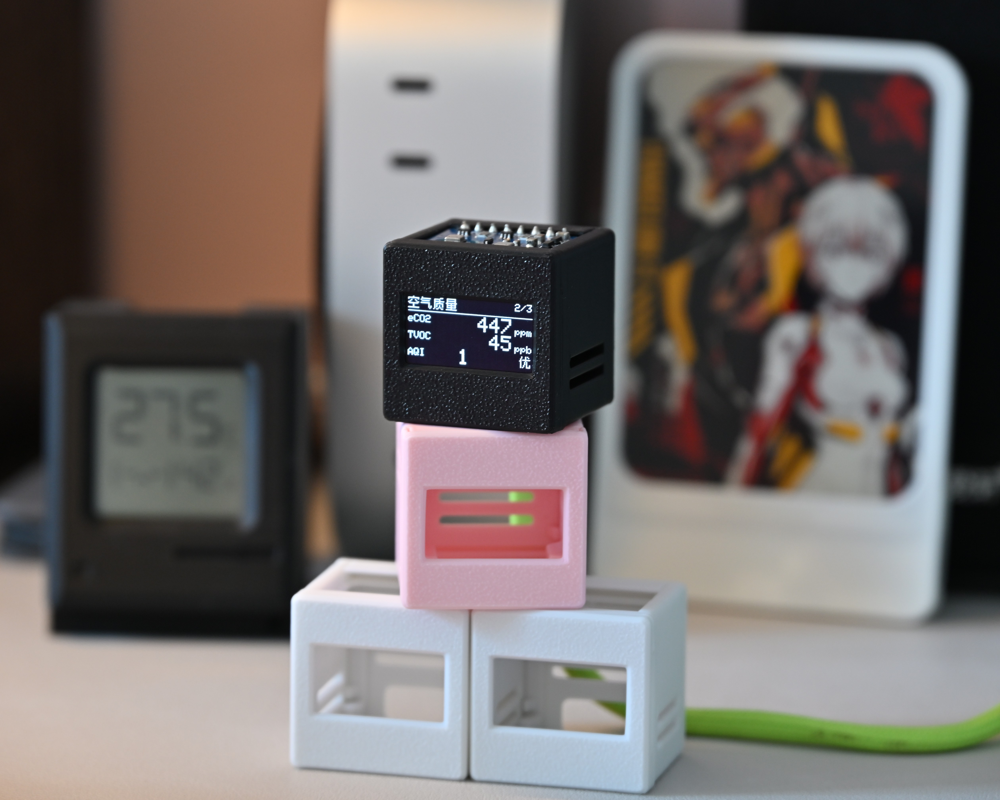

# 室内空气质量监测仪（ESP32-C3 + ENS160 + AHT30 + OLED）

采用 ESP32-C3 Mini 的室内空气质量实时监测仪，通过 ENS160 空气质量传感器与 AHT30 温湿度传感器采集数据，在 0.96 寸 SSD1306/SSD1315 OLED（128×64）上以中文界面分页显示，并提供基于 ESPHome 的 Home Assistant 接入方案。

三页自动轮播：温湿度 → 空气质量 → 表情。表情页会根据空气质量与舒适度切换 8 种情绪，并带有眨眼、扫视与切换过渡动画。

GitHub 仓库：[EndThemex/co2](https://github.com/EndThemex/co2)

国内访问：[Gitee/EndTheme/co2](https://gitee.com/EndTheme/co2)



## 监测指标

| 指标     | 说明                                                  | 单位 |
| -------- | ----------------------------------------------------- | ---- |
| AQI      | 空气质量指数（1–5 级）                                | 级   |
| eCO₂     | 等效二氧化碳                                          | ppm  |
| TVOC     | 总挥发性有机物                                        | ppb  |
| 温度     | AHT30，经分段偏移校准                                 | °C   |
| 相对湿度 | AHT30，经分段偏移校准                                 | %RH  |
| 舒适度   | 由校准后的温湿度判定（偏冷/偏热/干燥/潮湿/舒适/正常） | —    |

## 硬件清单

| 组件                                     | 说明                                                         | 参考价 |
| ---------------------------------------- | ------------------------------------------------------------ | ------ |
| ESP32-C3 Mini 开发板                     | 主控，Wi-Fi + BLE                                            | \~¥13  |
| ENS160 空气质量 + AHT30 温湿度传感器模块 | I²C，输出 AQI / TVOC / eCO₂                                  | \~¥26  |
| SSD1306/SSD1315 OLED                     | 0.96 寸，128×64，I²C，地址 0x3C（本固件默认，常见还有 0x3D） | \~¥10  |

### 接线

所有设备共用 I²C 总线（SDA=GPIO8，SCL=GPIO9），供电 **必须 3.3V**（5V 会烧毁传感器）：

```
ESP32-C3 Mini          ENS160      AHT30       OLED
   3.3V  ────────────── VIN ────── VIN ────── VCC
   GND   ────────────── GND ────── GND ────── GND
   GPIO8 ────────────── SDA ────── SDA ────── SDA
   GPIO9 ────────────── SCL ────── SCL ────── SCL
```

## 目录结构

```
co2/
├── platformio.ini        # PlatformIO 工程配置（主固件）
├── src/
│   ├── main.cpp          # 主程序：传感器读取、温湿度校准、分页调度、刷新策略
│   ├── ui_pages.cpp      # 各页面绘制逻辑（硬件无关，仅依赖 Canvas 抽象）
│   ├── ui_face.cpp       # 表情引擎：情绪判定、动画与过渡帧
│   └── canvas_oled.cpp/h # Canvas 接口的 OLED 实现（Adafruit_SSD1306，差分刷新）
├── include/
│   ├── ui_layout.h       # 屏幕布局常量（双栏网格、最坏值宽度）
│   ├── ui_canvas.h       # 抽象 Canvas 接口（文本宽度、绘图原语）
│   ├── ui_pages.h        # 页面声明与数据结构
│   ├── ui_face.h         # 表情引擎声明与情绪映射
│   ├── ui_face_bitmaps.h # 表情位图（由 tools/gen_face_bitmaps.py 生成）
│   └── font_cn.h         # 12×12 中文字模（由 tools/gen_cn_font.py 生成）
├── tools/                # PC 端 UI 模拟器、布局校验与字模生成脚本
│   ├── ui_sim.cpp        # 模拟器入口（ASCII 字符预览）
│   ├── canvas_console.cpp/h  # Console Canvas 实现（5×7 ASCII 字模）
│   ├── verify_layout.py  # 布局校验：像素级比对 + 最坏值宽度检查
│   ├── layout_lab.html   # 浏览器布局实验台（可导出 ui_layout.h，单文件离线可用）
│   ├── gen_cn_font.py    # 生成中文字模 include/font_cn.h
│   ├── gen_face_bitmaps.py   # 生成表情位图 include/ui_face_bitmaps.h
│   └── Makefile / build_sim.bat  # 模拟器构建脚本（GNU make / MSVC）
├── esphome/              # ESPHome 固件方案（接入 Home Assistant），见 esphome/README.md
├── docs/
│   ├── plan.md               # 项目完整实现方案与排障手册
│   ├── plan_ui_sim.md        # UI 抽离 + 模拟渲染器设计说明
│   ├── plan_weather.md       # ESPHome 联网天气页实现文档（规划中）
│   └── sensor-specs-scan-AHT21-ENS160.pdf  # 传感器模块规格扫描件（购买时附）
├── imgs/                 # 实物照片
└── release/              # 预编译合并固件 firmware.factory.bin
```

## 固件方案

项目提供两套固件：

1. **Arduino/PlatformIO 固件**（根目录）——本地分页显示，无需联网
2. **ESPHome 固件**（`esphome/`）——接入 Home Assistant，编译烧录步骤详见 [esphome/README.md](esphome/README.md)

ESPHome 方案通过 `includes` 复用同一份 `ui_pages.cpp` / `ui_face.cpp` / `ui_layout.h`；但 ESPHome 的字体度量与固件不同（单位宽度、字形着墨高度），因此页面坐标在 `esphome/co2.yaml` 内单独维护，不直接套用 `ui_layout.h` 的坐标值。

### 编译与烧录（PlatformIO）

```bash
# 编译
pio run

# 烧录（COM5 换成实际串口号）
pio run -t upload --upload-port COM5

# 查看串口日志
pio device monitor
```

依赖库由 `platformio.ini` 自动拉取：SparkFun ENS160（v1.1.0）、Adafruit GFX、Adafruit SSD1306。

也可以直接使用仓库内预编译的 [firmware.factory.bin](./release/firmware.factory.bin)，从 `0x0` 烧录。

## 界面与 UI 架构

### 页面

| 页面     | 内容                                                                |
| -------- | ------------------------------------------------------------------- |
| 温湿度   | 温度（°C）、湿度（%RH）、舒适度状态词                               |
| 空气质量 | eCO₂（ppm）、TVOC（ppb）、AQI 等级与质量词（优/良/中/差/很差/未知） |
| 表情     | 全屏 IrisOLED 表情：8 种情绪 + 眨眼/扫视/过渡动画                   |

每页停留 8 秒自动轮播。传感器采样与情绪评估为 1 Hz；数据页每 500 ms 重绘；表情页约 30 fps。屏幕刷新采用差分策略：每帧先 `memcmp` 比较缓冲，只有画面实际变化时才通过 I²C 推屏。

以上为 PlatformIO 固件的刷新参数；ESPHome 端由 `display` 组件的 `update_interval: 200ms` 驱动（5 fps），动画节奏相应放缓。

### 布局规则

数据页不显示标题和页码，整页按 **两个 64px 栏** 组织（温湿度页为温度/湿度，空气质量页为 eCO₂/TVOC）：

- 标签与单位共用一行（中文标签 12×12，ASCII 标签/单位 6×8）
- 数值独占整栏宽度并左对齐，最大 5 位（如 `-45.5`、`65535`，60px）仍能放进 64px 栏
- 底部状态带放舒适度或 AQI 信息；所有坐标与最坏值预算集中在 `include/ui_layout.h`

中文字模只包含界面实际用到的字符（白名单见 `tools/gen_cn_font.py`）。新增中文文案时必须同步扩充白名单并重新生成 `include/font_cn.h`；ESPHome 端则需同步修改 `co2.yaml` 中 `font.glyphs` 的字符集。

### UI 开发工具

UI 代码与硬件解耦：页面绘制只依赖抽象 `Canvas` 接口，同一份代码既能驱动 OLED，也能在 PC 上以 ASCII 字符预览。

```bash
cd tools

# 构建模拟器（二选一）
build_sim.bat        # Windows + MSVC（需 VS2022）
make                 # GNU make + g++

# 预览
ui_sim               # 交互模式，回车切页
ui_sim --all         # 一次性输出全部页面
ui_sim 3 8           # 第 3 页（表情）连续渲染 8 帧，每帧前进 150ms

# 布局校验：ASCII 元素逐像素比对 + 5 位数值/AQI 最坏宽度检查
python verify_layout.py
```

`tools/layout_lab.html` 可直接用浏览器打开，用于离线调整和预览 128×64 布局；调好后点击「导出 ui_layout.h」，选择 `include/ui_layout.h` 即可直接写回布局常量。字模/位图生成脚本：

```bash
python tools/gen_cn_font.py       # 依赖 Pillow；读取 esphome/fonts 下的像素字体
python tools/gen_face_bitmaps.py  # 需先把 IrisOLED 仓库克隆到 %TEMP%\Irisoled
```

## ENS160 校准与温湿度补偿

- **预热**：初次上电需连续通电约 1 小时进行初始校准；连续通电 24 小时后校准数据写入传感器内部存储，之后每次启动约 3 分钟就绪。
- **温湿度补偿**：eCO₂/TVOC 测量依赖 AHT30 的温湿度数据进行补偿，每次读取前必须写入。
- **显示校准**：ENS160 加热板会使 AHT30 测得的温度偏高、湿度偏低。`src/main.cpp` 采用"双轨 + 分段偏移"策略——原始值直接喂给 ENS160 补偿，显示值按区间查偏移表修正。
- **ESPHome 方案**：同样保留原始值补偿与校准值显示两条链路，偏移表以 lambda 形式写在 `esphome/co2.yaml` 中，可按实测重新标定。

## 常见问题

| 问题                              | 解决方法                                                                                                    |
| --------------------------------- | ----------------------------------------------------------------------------------------------------------- |
| OLED 不显示                       | 检查 I²C 地址（常见 0x3C / 0x3D）与接线                                                                     |
| 编译报错 `Wire1`                  | 已通过 main.cpp 首行 `#define SOC_HP_I2C_NUM 2` 解决                                                        |
| 温度偏高 / 湿度偏低               | ENS160 热板烘烤 AHT30，根据实际值调整偏移量                                                                 |
| ENS160 无数据                     | 检查 RESET→IDLE→CLEAR→STANDARD 初始化序列                                                                   |
| 刚上电读数不准 / eCO₂ 恒为 400ppm | 正常现象：ENS160 每次启动需约 3 分钟预热；全新传感器首次需连续通电 \~1 小时初始校准                         |
| 中文显示为空白 / 方框             | 固件：扩充 `tools/gen_cn_font.py` 的白名单后重新生成 `font_cn.h`；ESPHome：扩充 `co2.yaml` 的 `font.glyphs` |
| 数值与标签重叠 / 超出屏幕         | 运行 `python tools/verify_layout.py` 校验最坏宽度，再按 `ui_layout.h` 双栏规则调整坐标                      |

## 开源协议

本项目采用 [GPL-3.0](LICENSE) 协议开源（Copyright © 2026 EndTheme）。

- ✅ 允许任何个人或商业用途使用、修改、分发本项目
- ⚠️ 分发（含商用）时**必须保留原作者版权声明**
- ⚠️ 基于本项目修改后的固件/源码**必须以 GPL-3.0 协议完整开源**
- 本项目不提供任何担保，详见协议原文

第三方资源：表情位图来自 [IrisOLED](https://github.com/orji123/Irisoled)（MIT）；界面字体 Press Start 2P、Fusion Pixel 12px（OFL）与 Roboto Mono（Apache-2.0）。
